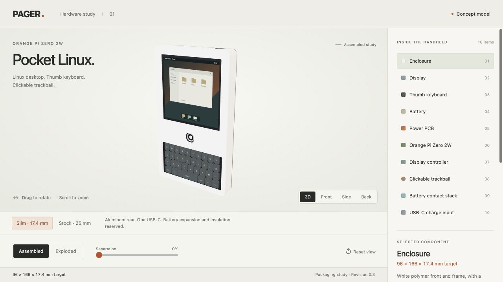

# Pager

A pocket Linux computer concept with a thumb keyboard, clickable trackball and a single external USB-C opening. This repository contains the self-contained CAD generator and geometry checks for the slim packaging study.



*CAD concept, not a photograph of a built device. The 96 x 166 x 17.4 mm envelope is a design target.*

## What this repository demonstrates

The model reserves space for the display, computer, keyboard, trackball, battery, power board and internal connectors. The generator builds a grip dummy and an assembly of component envelopes, then checks collisions and the battery stack before exporting STEP and STL files.

The slim model separates the battery divider, expansion space and insulating thermal interface. A component crossing a rounded enclosure wall, intersecting another reservation or breaking the declared stack causes validation to fail.

## Design constraints

| Item | Current target or status |
| --- | --- |
| Enclosure | 96 x 166 x 17.4 mm |
| Keyboard | 35-key thumb layout, mechanics untested |
| Pointing | Clickable trackball reservation |
| Front and side walls | 1.4 mm allowance |
| Rear | 1.0 mm aluminum study, stiffness unverified |
| Battery | Protected pack reservation, no selected production pack |
| Computer | Orange Pi Zero 2W envelope in this study |
| Display | Thin panel/controller pair still requires selection and bench testing |

The 17.4 mm target depends on parts fitting the reserved volumes. The existing stock display cannot simply be scaled down to fit. Actual cable bends, pack tolerances, fasteners and thermal behavior may require a larger enclosure.

## Build and test

Use Python 3.12 and [uv](https://docs.astral.sh/uv/).

```sh
uv sync --group dev
uv run python mechanical/build_slim.py
uv run pytest -q
uv run ruff check .
```

The generator writes the current grip dummy, assembly STEP and a JSON check report under `mechanical/`. It also creates a copy of the generated files under `preview/dist/assets/` for a future viewer build.

The public source snapshot regenerated the CAD and passed **24 tests on November 9, 2026**. The tests cover export dimensions, positive solid volume, USB-C cutout, invalid units, wall/collision rejection and verification flags. This is geometry validation. No physical fit, keyboard, RF, runtime or thermal result is claimed.

## Read the implementation

- [`mechanical/slim-layout.json`](mechanical/slim-layout.json) defines the dimensions, component envelopes and battery-stack contract.
- [`mechanical/geometry.py`](mechanical/geometry.py) checks finite dimensions, enclosure boundaries and intersections.
- [`mechanical/build_slim.py`](mechanical/build_slim.py) generates the CAD and reports.
- [`mechanical/test_slim.py`](mechanical/test_slim.py) exercises the geometry and exported files.

The public snapshot contains the current slim design. The older stock-parts model, external vendor CAD and personal planning notes are excluded. The image above records the existing project viewer; that viewer is not part of this source package.

## Next build gate

Prove the chosen computer and display on a bench, then measure the actual connectors, trackball, keyboard mechanics and protected pack. Update the model with those measurements before committing to the enclosure or custom power PCB. Closed-case testing must establish battery clearance, heat flow and controlled Linux shutdown.
